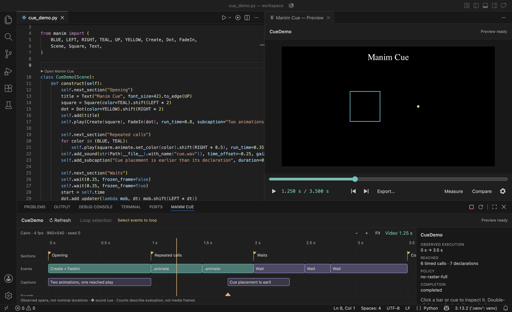

# Manim Cue

Manim Cue shows the frames, the timeline and the video of a Manim scene in VS Code while
you edit the scene.



- See the frame at the selected time soon after you save.
- Read the plays, waits, sections, captions and sounds of the scene on a timeline.
- Play the video, and loop a part of it.
- Go from a timeline entry to its line in the Python source.
- Compare two frames with a wipe or an overlay.
- Measure coordinates and distances in scene units.
- Save a frame, the video or the timeline, or render a new video.

## Get started

You need desktop VS Code 1.96 or newer, the Microsoft Python extension and Python 3.11
or newer.

> [!IMPORTANT]
> **Manim Cue needs a preview version of Manim**, from the `refactor/audio-mixer` branch.
> The command **Manim Cue: Set Up Python Environment** installs it into a new `.venv`
> in your project folder. With `uv` on VS Code's `PATH`, the setup uses `uv` and
> Python 3.13. Otherwise it uses the Python interpreter that you selected in VS Code.
>
> To install the branch into an existing uv project:
>
> ```sh
> uv add "manim @ https://github.com/ManimCommunity/manim/archive/refs/heads/refactor/audio-mixer.zip"
> ```
>
> To install it with pip into an active virtual environment:
>
> ```sh
> pip install --upgrade --no-cache-dir "manim @ https://github.com/ManimCommunity/manim/archive/refs/heads/refactor/audio-mixer.zip"
> ```
>
> Manim can also need [system packages](https://docs.manim.community/en/stable/installation.html)
> for Cairo, text and video. Cue checks the features of the installed Manim:
> **Manim Cue: Check Python Environment** shows the result.

1. Find **Manim Cue** in the Extensions view and choose **Install Pre-Release Version**.
   To install a downloaded VSIX file, use **Extensions → … → Install from VSIX…**.
2. Open the folder of your scene and trust the workspace.
3. Run **Manim Cue: Set Up Python Environment**. Or install Manim yourself and select
   that environment with **Python: Select Interpreter**.
4. Run **Manim Cue: Check Python Environment**. The result must be **Ready**.
5. Open a saved Python file with a `Scene` class.
6. Click **▶ Open Manim Cue** above the class, or run **Manim Cue: Open Scene**.

To try Cue first, open the example scene `examples/cue_demo.py`.

## Everyday use

Save the scene file. Cue updates the frame at the selected time first, then the
timeline, then the video. Until the update is ready, the old frame stays visible with
the label **OUTDATED**.

Drag the scrubber or click the timeline to choose a time. In the preview, **Space**
plays or pauses, and **Left** and **Right** step one frame. Select plays and waits on
the timeline and turn on **Loop selection** to repeat that part.

The buttons above the preview:

- **Export…** saves the frame, the video or the timeline, or renders a new video.
- **Compare** keeps a frame as the reference and compares later frames with it.
- **Measure** shows scene coordinates and measures distances.
- **Settings** (the cog) opens the preview width, the frame rate and **Render Video
  Automatically**.

Playback in the preview is silent; exported videos have sound, and the timeline shows
the sounds. Measurement uses the coordinates of a centred 2D camera.

Your scene runs as normal Python code with your account's access to files, the network
and other programs. Open scenes and plugins that you trust.

## Learn more

- [Use the preview, the timeline, export, comparison and measurement](docs/usage.md)
- [Select Python and solve problems](docs/troubleshooting.md)
- [Make updates faster and clear caches](docs/performance.md)
- [How an update works](docs/architecture.md)
- [Development and tests](docs/development.md)

[Third-party notices](THIRD_PARTY_NOTICES.md) · [License](LICENSE)
